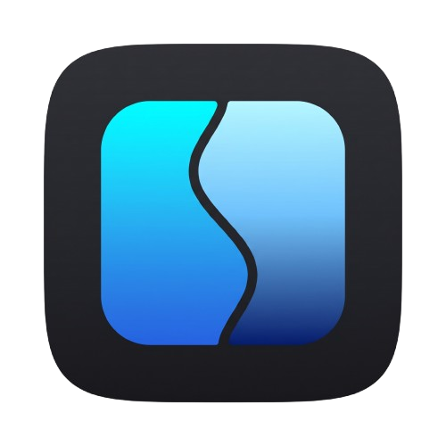

<h1 align="center">
  <br>
  Stela — Intel Edition
</h1>

A translation-based Apple Silicon layer for Intel x86-64 PCs. This fork focuses
on Intel hardware support, featuring a UEFI boot program with an arm64-to-x86-64
translator, a Metal driver in development for Intel GPUs (Intel Arc & Xe), and
a model of Apple silicon hardware. Stela currently presents itself as an M2 Mac
mini.

> [!WARNING]
> This Intel-focused fork of Stela is experimental and still in active development. Intel GPU support is a work in progress — it may be slow or fail to boot on supported hardware. Please submit a GitHub Issue with your boot logs if you encounter an error!

## Translator

An ahead-of-time and just-in-time compiler translates arm64e code to x86-64.
It covers more than 3,000 AArch64 instruction encodings, maps guest registers
to host registers and caches translated code.

## Intel driver

The Metal driver compiles AIR, Metal's shader IR, directly to NIR, Mesa's IR,
targeting Intel Arc and Intel Xe (Gen 12+) GPUs with support for the Metal3
and Apple7 GPU families (work in progress).

## Hardware requirements

| Part | Requirement |
|---|---|
| CPU | Intel x86-64-v2 (Nehalem or newer; Intel Core 12th Gen+ and Intel Core Ultra recommended). AVX2 and AVX-512 are used when present. |
| Memory | 8 GB or more (16 GB recommended). |
| Firmware | 64-bit UEFI with Secure Boot off. |
| GPU | Intel Arc (Alchemist, Battlemage, Meteor Lake, Arrow Lake) and Intel Xe (Gen 12+) GPUs *(work in progress)*. |
| Disk | NVMe, or SATA in AHCI mode. 60 GB or more for macOS: a GPT partition or a whole disk to erase. |
| USB stick | 8 GB for the Online installer, 32 GB for the Offline installer. |
| Ethernet | Intel I225, I226, I210, I211, I350, 82574L, 82575, 82576, 82579, 82580, I217, I218, I219.<br>Realtek RTL8111, RTL8168, RTL8169, RTL8411, RTL8125, RTL8126, Killer E2600, E3000.<br>Broadcom BCM5720, BCM5761, BCM5762.<br>Aquantia AQC100, AQC107, AQC108, AQC109, AQC111, AQC112, AQC113, AQC114, AQC115C, AQC116C.<br>Qualcomm Atheros AR8131, AR8132, AR8151, AR8152, AR8161, AR8162, AR8171, AR8172, Killer E2200, E2400, E2500.<br>USB: Realtek RTL8152, RTL8153, RTL8156, ASIX AX88179, AX88178A, AX88772, CDC ECM and NCM. |
| Wi-Fi | Intel Wi-Fi adapters *(experimental, configured via `--wifi`)*. |
| Bluetooth | None currently supported. |
| Audio | None currently supported. |
| USB | xHCI (USB 3) and EHCI controllers, hubs, USB disks. |
| Input | USB keyboards and mice. PS/2 keyboards, mice and Synaptics or Elantech touchpads. |

## Install

1. Download `stela` from the
   [releases page](https://github.com/OlegFlow4/Stela-Intel/releases) or build it from source.
2. Run `sudo ./stela` (Linux, macOS) or double-click `stela.exe`
   (Windows).
3. Choose the USB stick and the installer, then confirm. This erases the USB
   stick.
4. Boot the PC from the USB stick.

## Update

Download the new `stela`, plug the USB stick in and run:

```sh
sudo ./stela update
```

On Windows, open Terminal with Run as administrator and run:

```
.\stela.exe update
```

## Logs

If Stela does not work, plug the USB stick into any computer with `stela` and
save the boot log. Include `log.txt` in your GitHub Issue. Save it before you
start Stela again many times: the log keeps the start of each of the last
eight boots, but only the latest part of a long run.

```sh
sudo ./stela log --output log.txt
```

On Windows, open Terminal with Run as administrator and run:

```
.\stela.exe log --output log.txt
```

## Build

You need [Rust](https://rustup.rs), git, Python 3.10 or newer, and LLVM 21,
22 or 23 with Clang, LLD and libclang. On macOS, Xcode's Apple clang 21 or
newer also works.

```sh
git clone https://github.com/OlegFlow4/Stela-Intel
cd Stela-Intel
cargo xtask dist
```

This writes `target/release/stela`. The first build fetches and compiles
Linux, Mesa and LLVM sources and takes a long time.

## Legal

Stela contains no Apple software. You are responsible for following Apple's
software license agreement and terms of use.

Stela's code is GPL-2.0-or-later. See [LICENSE](LICENSE) and [NOTICE](NOTICE).

## Community

<p align="left">
  <a href="https://discord.gg/aSkwrJEMYc">
    
  </a>
</p>